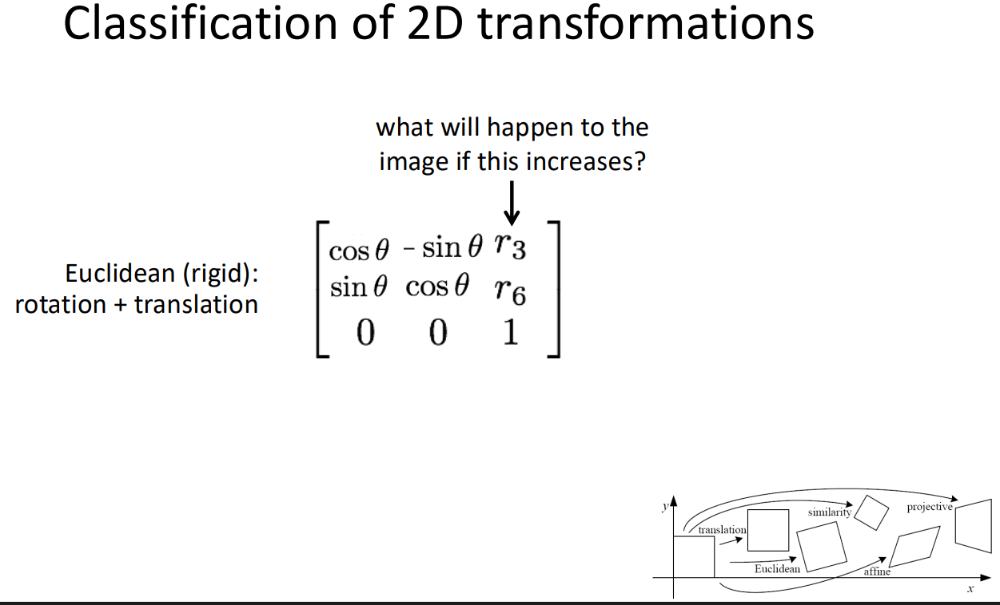
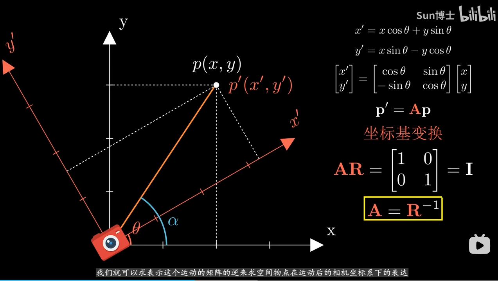

如果矩阵中的 $r_3$ 增加，图像将会向右平移（水平向右移动）。

这个问题取决于你是**仅仅单独改变矩阵左上角的这一个数值**，还是**改变了旋转角度 $\theta$ 从而导致 $\cos\theta$ 的值增加**。这两种情况对应的物理意义完全不同：

### 情况一：仅仅单独增加左上角的数值（改变了变换性质）
如果矩阵中的其他元素（$-\sin\theta$, $r_3$ 等）都保持不变，仅仅是左上角位置的值（我们记作 $m_{11}$）变大了，那么：
**图像会沿着水平方向（X轴）发生拉伸变形。**

**原因解释：**
根据矩阵乘法，变换后的新横坐标 $x'$ 的计算公式为：
$$x' = m_{11} \cdot x - y\sin\theta + r_3$$
如果 $m_{11}$ 增加，意味着原始图像的横坐标 $x$ 会被乘以一个更大的系数。这会导致图像在水平方向上被放大或拉宽。

*注：一旦你单独改变了这个值，这个矩阵就不再满足截图左侧标注的“Euclidean (rigid)”（欧几里得/刚体变换）条件了，因为它不再保持物体的原始形状，而是变成了一种包含非等比例缩放的仿射变换（Affine transformation）。*

### 情况二：旋转角度 $\theta$ 改变，导致 $\cos\theta$ 变大
如果矩阵依然严格保持为一个刚体变换矩阵（即矩阵中的两个 $\cos\theta$ 和两个 $\sin\theta$ 随着同一个角度联动变化），仅仅是因为角度 $\theta$ 变了使得 $\cos\theta$ 变大，那么：
**图像会顺时针旋转（或者说旋转的幅度变小，趋向于摆正）。**

**原因解释：**
在三角函数中，$\cos\theta$ 的最大值是 **1**（此时角度 $\theta = 0^\circ$）。
通常在逆时针旋转的设定下（如 $0^\circ$ 到 $90^\circ$ 的区间），角度 $\theta$ 越小，$\cos\theta$ 的值反而越大。
因此，如果 $\cos\theta$ 正在增加，说明旋转角度 $\theta$ 正在逐渐减小并逼近 $0^\circ$。在视觉上，这表现为图像正在消除原本的逆时针旋转，向顺时针方向转回它最开始、未旋转的原始状态。

