通信网：由终端设备、交换设备、传输设备，结合信令过程、
协议和支撑运行系统组成的网络。

电路交换，也被称为程控交换
实时性强，时延小；对差错不敏感。
(1) 按信息表示形式分：模拟和数字交换机
(2) 按交换机构组织形式分：空分和时分交换机
(3)按控制方式分：人工、布控逻辑和存储程序控制交换机

---

1.2.1电路交换：特点
面向连接（物理连接）
同步时分复用： 时隙
固定分配带宽
对信息进行透明传输
信息传送无差错控制
适用于话音业务
❖ 电路交换的优点
 时延小，通信质量有保证；
 控制简单；
❖ 电路交换的缺点
 呼叫建立需要时间；
 每个连接带宽固定（不能适应不同速率的业务）；
 不传信息时也占用资源（不适用于突发业务）；
 对信息无差错控制，不适合差错敏感的数据业务；
 流量控制是基于呼叫损失制的。

---

多速率电路交换(MRCS)
(1)采用一个统一的多速率交换网络，设置多种基本信道速率
(2)采用多个不同速率的交换网络
1.2.2 多速率电路交换：特点
❖ 本质还是电路交换技术；
❖ 速率是事先定制好的，不能任意更改，灵活性不够；
❖ 不能真正适应突发业务的特点；
❖ 交换系统比较复杂，实现成本偏高

---

基本的报文交换动作是存储报文、分析报文中的收报人地址和报文转
发；
❖ 优点
中继线利用率高，多个用户报文按“先来先服务”的工作顺序共同
使用中继线路；
 采用“存储——转发”方式，可实现不同速率的各种突发性业务
的信息传输；
 能进行差错控制。
❖ 缺点
以报文为单位传输，长报文在网络中占用大量的存储空间和时延，
影响其后多个短报文的发送，因此对要求传输时延较短的数据业务
不适应。

---

❖ 分组交换(Packet Switching)综合了电路交换和报文交换的优点，同时对它们的缺点进行改进，分组交换比较好地支持了数据通信，是现代通信网络的基础交换技术。
❖ 采用存储转发方式的分组交换与报文交换的不同在于：分组
交换将用户要传送的信息分割为若干个分组，每个分组中有
一个分组头，含有可供选路的信息和其他控制信息。
❖ 分组：为保证传输时延小，交换效率高，将报文截成许多短
的、限长的、统一格式的分组(Packet)，直接在内存中排队
和处理。
❖ 存储转发：各个分组要携带源、目的地址，供交换机路由选
择。
❖ 有序号：各个分组可能走不同的路径，因此要携带序号，使
接收端能将各个分组按序重组成长报文。
❖ 实质：“分组—存储—转发”传送信息。

---

1.2.5分组交换：分类
数据报DG:(Datagram，无连接)❑ 每个分组包含完整地址信息，独立寻找路由；
❑ 分组到达的顺序不同，传输时延大，时延
差别大；
❑ 对网络故障适应性强。
虚电路VC(Virtual Circuit，面向连接)❑ 每次通信要有建立连接、分组传送、清除连接
三阶段；
❑ 虚电路建立后，属于同一呼叫的数据分组均沿
着同一虚电路传送，它不同于电路交换中的物理
连接，而是逻辑连接；
❑ 传输时延小，时延差别小，分组有序到达，网
络故障时要重新连接。

1.2.5分组交换：2种方式比较
选 路
❑ VC方式一旦虚电路建立，在端到端之间所选定路由上
的各个交换节点都具有映象表，存放出入逻辑信道的对应
关系，每个分组到来时只要查找映象表，而不需要进行复
杂的选路。
❑ DG方式无通路建立过程，对每个分组独立进行选路
时 延
❑ VC方式按映像表选路，时延小。
❑ DG方式按分组头的地址信息选路，时延大。
信息有序性
❑ VC方式所有分组沿同一路径传输，能够保证有序性；
❑ DG方式各个分组沿不同路径传输，信息无序到达。
分组头
❑ VC方式由于预先已建立逻辑连接，分组头中只要含有
对应于所建立的VC的逻辑信道标识。
❑ DG方式的每个分组头中要包含详细的目的地址；
故障敏感性
❑ VC方式对故障较为敏感，当传输链路或交换节点发生
故障时可能引起虚电路的中断，需要重新建立。
❑ DG方式中各个分组可选择不同路由，对故障的防卫能
力较强，从而可靠性较高。
应用
❑ VC方式适用于较连续的数据流传送，其持续时间应显
著地大于呼叫建立的时间，如文件传送、传真业务等。
❑ DG方式则适用于面向事务的询向／响应型数据业务。
---
虚电路和数据报的对比
1.2.5分组交换：2种方式比较
虚电路 数据报
连接的建立 必须有 不要
目的站地址 仅在连接建立阶段使用 每个分组都有目的站地址
路由选择 在虚电路建立时进行 每个分组独立选择路由
故障处理 相关虚电路都不能工作 可变化路由
分组顺序 按发送顺序到达目的站 可能不按序到达
差错处理 由通信子网负责 由主机负责
流量控制 由通信子网负责 由主机负责

---

1.2.5分组交换：特点
❖ 面向（逻辑）连接和面向无连接两种工作方式
❖ 统计时分复用
❖ 可变带宽
❖ 信息传送不具有透明性，但语义透明
❖ 信息传送有差错控制和流量控制
❖ 适用于数据业务

❑ 电路交换具有较好的时间透明性；
❑ 分组交换具有较好的语义透明性。

---

1.2.6帧交换： X.25协议
❖ 分组交换基于X.25协议，该协议包含了3层，第一层物理层，
第二层数据链路层，第三层分组层，对应于OSI模型的下三
层。
❖ 分组交换的低速率主要是由复杂的协议处理导致的，特别是
需要在各段链路上进行差错控制和流量控制
❖ 方法
交换结点只在物理层和数据链路层上进行差错控制；
 数据链路层上传送的基本数据交换单元为帧
差错控制方式由点-点改为端-端；

---
1.2.8 ATM交换
❖ 异步传送模式（ATM）的提出
❑ 电路交换特点
同步时分复用；固定分
配带宽；时间透明性
❑ 分组交换特点
统计时分复用；动态分
配带宽；语义透明性

❖ 目标
综合电路交换和分组交换的优点，支持所有业务。
❖ 思路
采用信元交换。
❖ 方法
存储转发，异步传送模式——适应不同速率要求；
 以更小的定长分组（信元）传送，减少存储转发的时延；
 面向连接，减少时延差，保证传输有序；
 取消逐段的差错控制——支持透明、实时传输。
❖ 信头简化
ATM信元的信头功能有限，主要是虚连接的标识，还有优先级标志、
信头的差错检验等。
❖ 面向连接
ATM采用面向连接的方式。即用户信息传送前，先要有连接建立过
程，在信息传送结束后，要拆除连接。
 它不是物理连接，而是一种虚连接(VC，Virtual Connection)。

虽然是同一种技术，但两个名称侧重的特征不同：
称为“统计”时分复用（侧重于资源分配的依据）：
称为“异步”时分复用（侧重于时间槽的特征）：

---
Q:为什么ATM交换能融合电路交换和分组交换的优点?

**ATM是以分组传送模式为基础并融合了电路传送模式高速化的优点发展而成的**。它通过以下几个核心机制的设计，成功实现了两者优势的互补：

**1. 吸收分组交换的优势（实现灵活性与高利用率）：**
*   **异步时分复用与动态带宽分配**：ATM采用了异步时分复用（或称统计时分复用）技术以及存储转发机制。这克服了电路交换因同步时分复用带来的固定分配带宽、无法适应不同速率业务的缺点，使得带宽能够按需动态分配，从而灵活适应从低速到高速的语音、数据、图像和视频等任意业务。
*   **语义透明性**：ATM继承了分组交换较好的语义透明性，信息被分割封装成信元进行灵活传送。

**2. 融合电路交换的优势（实现高速性与实时性）：**
*   **采用短小且固定长度的信元**：ATM传送信息的最小单位是固定为53字节的信元。这种定长且极短的信元**极大地减少了交换节点内部的缓冲器容量，降低了排队时延和时延抖动**，满足了实时业务的要求。同时，固定长度十分有利于通过硬件来简化交换控制和缓冲器管理，实现高速交换。
*   **简化协议与取消逐段差错控制**：为了提高处理速度，ATM简化了传统分组通信中复杂的控制协议。**网络节点内部不再对信息进行逐段的流量控制和差错控制**（仅对重要的信头进行差错校验），从而极大地减少了处理开销，支持像电路交换一样的透明、实时的高速传输。
*   **面向连接的工作方式**：ATM在信息传送前需要先建立逻辑上的虚连接。这种方式**保证了信元传输的有序性，减少了时延差**，使得网络能在任何情况下保证最小的信元丢失率，从而获得类似电路交换的高传输质量和较好的时间透明性。
---
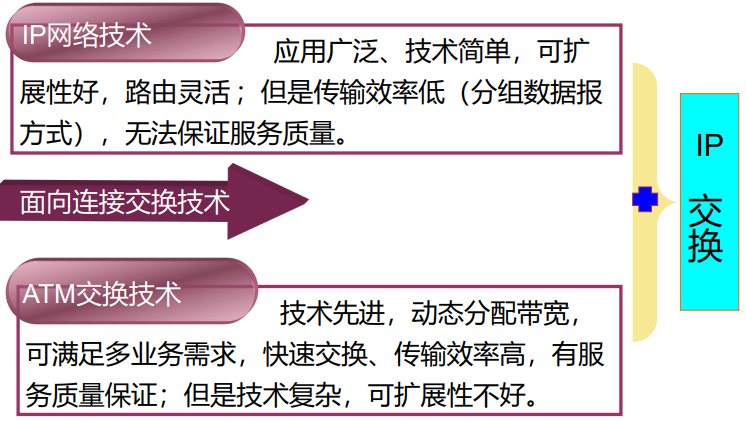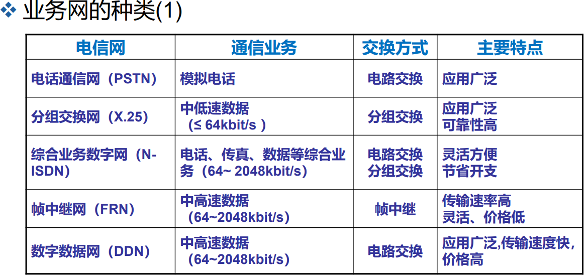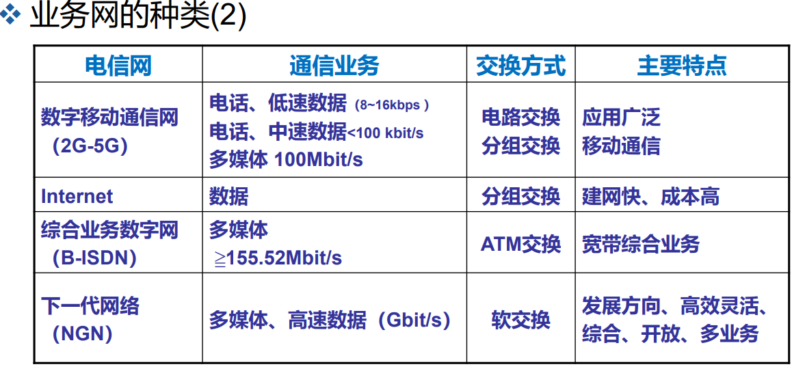
---
2.1电路交换的过程分为建立连接、传送信息和释放连接三个阶段。

2.2.1数字程控交换系统的基本结构：话路子系统、控制子系统

话路子系统是由交换网络和用户电路以及各种接口设备组成的。
控制子系统是交换机的“指挥系统”，交换机的所有动作都是在控制系统的控制下完成的。

按存在内部阻塞分类
 严格无阻塞交换网络：
 不管网络处于何种状态，只要连接的起点和终点是空闲的，在任何时刻都可以在交换网
络中建立一个新连接，且不会影响网络中已存在的其他连接。
 可重排无阻塞交换网络
 不管网络处于何种状态，只要连接的起点和终点是空闲的，任何时刻都可以在交换网络
中直接或间接地对已有的连接进行重新选路来建立一个新连接。
 广义无阻塞交换网络
 指一个给定的网络存在着有阻塞的可能，但又存在着一种精巧的选路方法，使得所有的
阻塞均可避免，而不必重新安排网络中已建立起来的连接。

按复用连接方式分类
 空分交换网络：交换网络在多对入线和出线之间同时并行的建立多对连接，
具有空间交换的功能。
 时分交换网络：如果交换网络在入线和出线之间分时共享共用的内部链路，
并进行时隙交换。
 时分—空分结合交换网络：同时具有空分交换和时分交换的功能，如中、
大容量的程控交换机几乎都采用时空结合的交换网络结构，如TST、STS
和DSN交换网络等
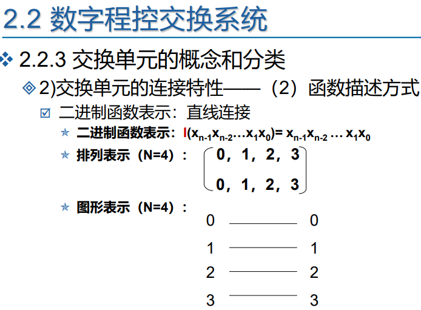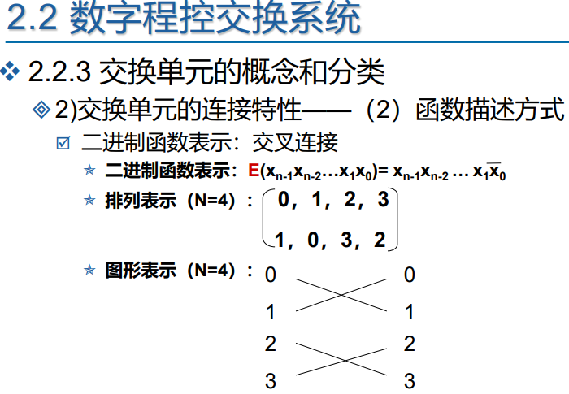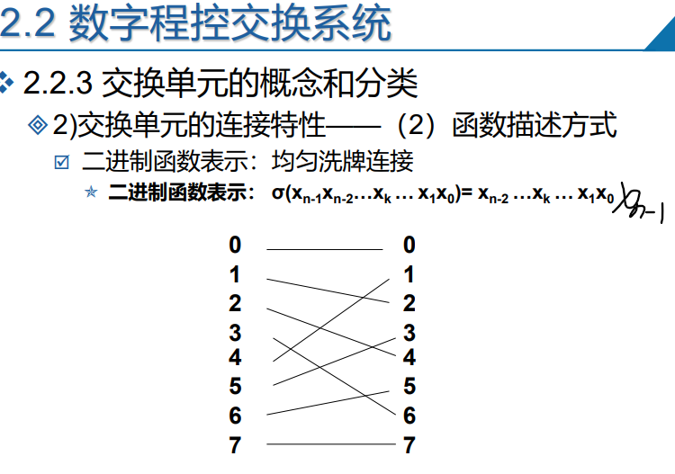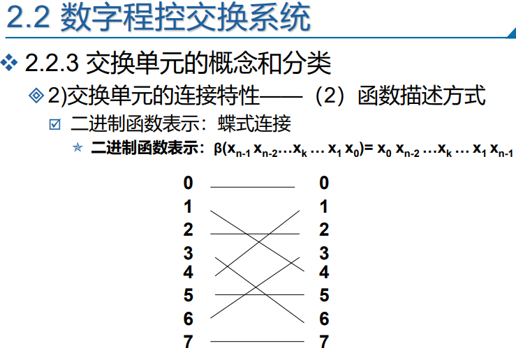
❖ 2.2.3 交换单元的概念和分类
空间交换单元——空分交换
   开关阵列
   空间接线器
 空间(S)接线器——基本结构
 交叉点矩阵：开关阵列。
 控制存储器（CM-Control Memory）：控制每条输入复用线与输出复用
线上的各个交叉点开关在什么时候打开或闭合。

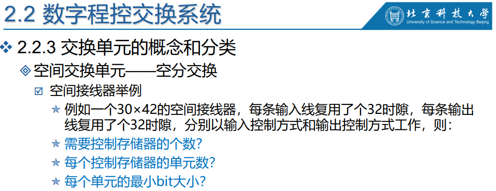
=
### 一、 输入控制方式

在输入控制方式下，系统为**每一条输入线**分配一个控制存储器（CM）。在这个 CM 中，记录着在每个特定的时隙里，这根输入线的数据应该发送到哪一条**输出线**上。

* **需要控制存储器的个数？**
    * **答案：30 个**。
    * **解析：** 因为是按输入线进行控制，所以 CM 的数量直接等于输入线的数量。
* **每个控制存储器的单元数？**
    * **答案：32 个**。
    * **解析：** 每个 CM 需要为每一帧的每一个时隙发出一根控制指令，因此单元数（字数）等于复用时隙数 $T$。
* **每个单元的最小 bit 大小？**
    * **答案：6 bit**。
    * **解析：** 单元内部存储的是**目标输出线**的地址。由于共有 42 条输出线，我们需要将其进行二进制编码。满足 $2^n \geq 42$ 的最小整数 $n$ 是 6（因为 $2^5=32 < 42 < 2^6=64$），因此最少需要 6 个 bit。

---

### 二、 输出控制方式

在输出控制方式下，系统为**每一条输出线**分配一个控制存储器（CM）。在这个 CM 中，记录着在每个特定的时隙里，这根输出线应该接收来自哪一条**输入线**的数据。

* **需要控制存储器的个数？**
    * **答案：42 个**。
    * **解析：** 因为是按输出线进行控制，所以 CM 的数量直接等于输出线的数量。
* **每个控制存储器的单元数？**
    * **答案：32 个**。
    * **解析：** 与输入控制同理，每个时隙都需要一次控制指令，所以单元数等于复用时隙数 $T$。
* **每个单元的最小 bit 大小？**
    * **答案：5 bit**。
    * **解析：** 单元内部存储的是**源输入线**的地址。由于共有 30 条输入线，对其进行二进制编码需要满足 $2^n \geq 30$ 的最小整数 $n$ 是 5（因为 $2^4=16 < 30 < 2^5=32$），因此最少需要 5 个 bit。

---
时分交换单元——1）时间(T)接线器的基本结构
 T接线器主要由话音存储器（SM:Speech Memory）、控制存储器
(CM:Control memory)构成和控制电路组成。
(1) 话音存储器 SM用来暂存话音的数字编码信息，SM的容量
等于输入复用线上每帧的时隙数，每单元大小8bit。
(2)控制存储器
用来控制话音存储器的读或写，它存放的内容
是话音存储器在当前时隙内应该写入或读出的地址。
其单元数等于SM的单元数，每单元大小满足$2^c≥n$,n为存储单元数

时分交换单元——1）时间(T)接线器的控制方式
 输出控制方式
 T接线器话音存储器SM的写入是在定时脉冲控制下顺序写入，其读出受控制存储器的
控制读出，即：顺序写入\控制读出；
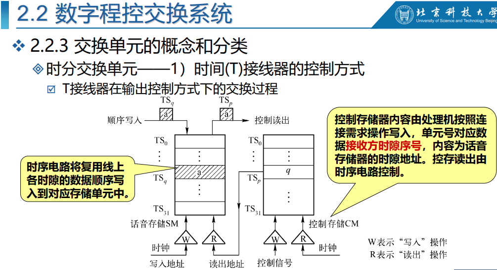
 输入控制方式
 T接线器话音存储器SM的写入受控制存储器控制，它的读出则是在定时脉冲的控制下
顺序读出，即：控制写入\顺序读出。
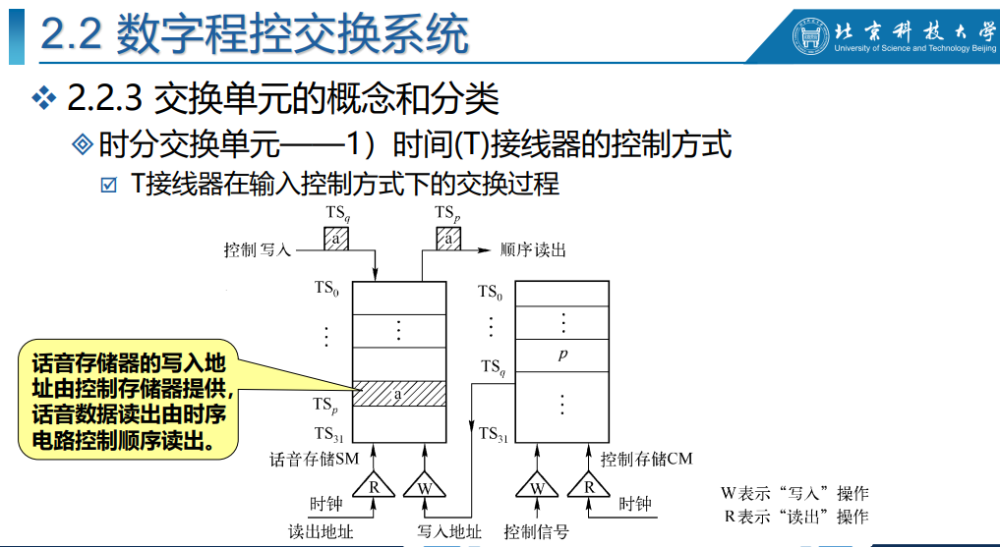

---
 例如一个时间接线器，输入输出复用线上的时隙数为32 ，传输PCM语音信
息，那么求：
 话音控制存储器单元的个数？
 话音控制存储器的最小容量为多大？
 控制存储器单元的个数？
 控制存储器的最小容量为多大
---

这是一道关于数字程控交换系统中**时间接线器（T接线器）**的经典计算题。

与前面提到的空间接线器（负责在不同物理线路间切换）不同，时间接线器的主要任务是**完成同一条复用线上不同时隙之间的数据交换**。它主要由两部分组成：话音存储器（SM）和控制存储器（CM）。

已知条件：
* **复用线时隙数（$T$）**：32
* **传输数据类型**：PCM 语音信息（标准的 PCM 语音编码每个时隙占用 **8 bit**）

以下是各个问题的详细解答：

### 1. 话音存储器（SM）单元的个数？
* **答案：32 个**。
* **解析**：话音存储器用于暂时存放输入复用线上的一帧数据。因为一帧包含了 32 个时隙，每个时隙的数据都需要一个专门的存储单元来存放，所以话音存储器的单元数等于复用线上的时隙数。

### 2. 话音存储器的最小容量为多大？
* **答案：256 bit**（或 32 Byte）。
* **解析**：总容量 = 单元个数 $\times$ 每个单元的字长。
    * 单元个数为 32。
    * 题目中明确是“PCM 语音信息”，标准 PCM 编码为 8 bit/时隙，因此每个存储单元的字长必须是 8 bit。
    * 最小容量 = $32 \times 8 = 256$ bit。

### 3. 控制存储器（CM）单元的个数？
* **答案：32 个**。
* **解析**：控制存储器用于控制在哪个时隙读出（或写入）哪个话音存储单元的数据。为了保证每个时隙都能被独立控制，控制存储器的单元数也必须等于复用线上的时隙数。

### 4. 控制存储器的最小容量为多大？
* **答案：160 bit**。
* **解析**：总容量 = 单元个数 $\times$ 每个单元的字长。
    * 单元个数为 32。
    * CM 中每个单元存储的是**话音存储器（SM）的地址**。由于 SM 共有 32 个单元，我们要对其进行二进制地址编码。满足 $2^n \geq 32$ 的最小整数 $n$ 是 5（因为 $2^5 = 32$），因此控制存储器每个单元最小需要 5 bit。
    * 最小容量 = $32 \times 5 = 160$ bit。

---

**核心总结：**
对于时间（T）接线器，你可以记住这个通用规律：
* **SM 和 CM 的单元个数**永远等于**复用线的时隙数**。
* **SM 的单元位宽**取决于**传输的数据类型**（通常 PCM 为 8 bit）。
* **CM 的单元位宽**取决于**需要寻址的 SM 单元数**（即对时隙数求以 2 为底的对数并向上取整）。

时分交换单元——时间接线器的工作原理
 CM：在一个时隙内至少完成一次读操作；
 SM：在一个时隙内完成一次读操作和一次写操作；

时分交换单元——时间接线器的工作特点
 时分交换，用于交换同步时分复用的信号。
 SM划分为N个区域，每个区域8bit，存放话音数据。各个区域间不共享，
无排队缓冲。
 交换的控制过程由硬件CM实现，速度快。
 严格无阻塞。
 可避免出线冲突。
 速率（带宽）固定为64kbit/s。
 经过时间接线器交换的信息存在着时延。
 （最小、最大的情况）
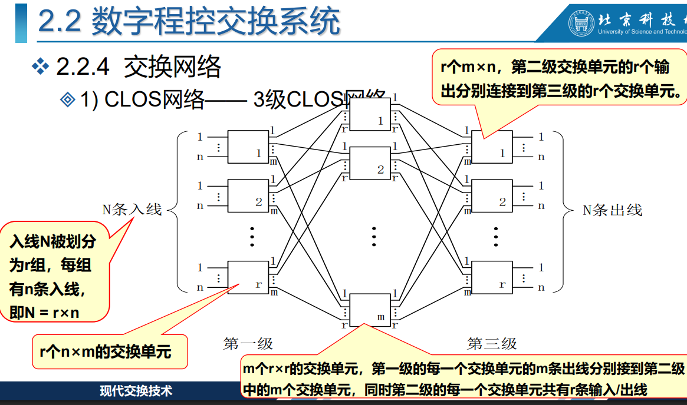
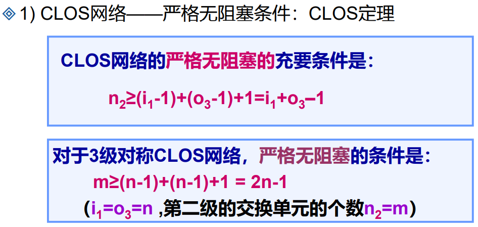

1) CLOS网络——可重排无阻塞网络条件
 对称3级CLOS网络可重排无阻塞的条件：m≥n
 其中:
 m为第2级所需要的交换单元的个数
 n为第1级交换单元入线数或第3级交换单元的出线数

3）TST交换网络——定义
 TST网络是在电路交换系统中经常使用的一种交换网络，它是三级交换网
络，两侧为T接线器，中间一级为S接线器，S级的出入线数决定于两侧T接
线器的数量。
 第1级T接线器：负责输入母线的时隙交换；
 第2级S接线器：负责母线之间的空间交换；
 第3级T接线器：负责输出母线的时隙交换。
3）TST交换网络——特点
 交换网络要建立双向通路，为简化控制， 内部时隙的选择一般采用“反相
法”，使两个方向的内部时隙相差半帧，即：
$N_b= N_a +N_f/2$
 其中：
 Nf=输入线或输出线能复用的时隙数；
 Na=A到B方向的内部时隙数；
 Nb=B到A方向的内部时隙数。
 好处：呼叫处理机可以一次选择两个方向的路由，避免二次路由选择，减轻了处理机负担。

呼叫处理能力BHCA
 BHCA计算模型
t ＝ a + bN
 t 为该交换机控制系统的系统开销；
 a为该交换机控制系统的固有开销；
 b为该交换机控制系统处理一次呼叫的非固有开销（平均值）；
 N为单位时间内所处理的呼叫总次数，即呼叫处理能力值（BHCA）；
 bN 为该交换机控制系统的非固有开销。

呼叫处理能力BHCA
 BHCA计算模型——BHCA例题
 例：某处理机忙时用于呼叫处理的时间开销平均为0.85，固有开销a=0.29，处理一个呼叫平均需时32ms，求其BHCA为多少？
 解: 由 t ＝ a + bN，得
 0.85=0.29+（32X10-3/3600）X N
 N=63000次/小时
---
3.2.1 报文交换与分组交换
 分组交换的思想是从报文交换而来的，同样采用“存储-转发” 方式，与报文
交换的不同在于：分组传输方式由于受到一次传输数据的最大长度的限制，需
要将用户要传送的信息分割为多个数据段，这些数据称为“分组”（packet），
每分组中有一个分组头，分组头中主要包含逻辑信道号、分组的序号及其它的
控制信息。

路由选择算法分类
 路由选择算法分为非自适应路由选择算法和自适应路由选择算法两大类。
 非自适应路由选择算法也叫静态路由选择策略。静态路由选择策略包括泛
洪式路由选择法、固定路由表法和随机路由选择法。
 自适应路由选择算法又称为动态路由选择策略，即节点的路由表根据网络
的负载和链路的状态而不断地变化。动态路由选择策略包括独立路由选择
法、集中式路由法和分布路由选择法。

路由选择算法分类——（3）随机路由选择
 当节点收到一个分组，节点随机选择一条除了分组来源的那条路由之外的
其它路由。
 随机路由选择方法的优点是比较简单、稳健性也较好。由此产生的通信量
负荷一般要高于最佳的通信量负荷，而低于洪泛法产生的通信量负荷。
 改进的随机路由选择方法是给每条输出路由分配一个概率，可根据概率来
选择路由。这个概率可以是基于数据率的，也可以是基于费用。

路由选择算法分类——（5）独立路由选择
 在这类路由算法中，节点只根据自己收集到的有关信息（如节点和线路当
前运行变化情况）动态作出路由选择的决定，而不与其它节点交换路由选
择信息，虽然不能正确确定距离本节点较远的路由选择，但还是能较好地
适应网络流量和拓扑结构的变化。如选择将报文分组排列在最短输出队列
节点上或排列在信息量最大、延迟小的队列节点上。

路由选择算法分类——（6）集中式路由选择
 集中式路由选择，同固定路由选择法一样，在每个节点上存储一张路由表；
但不同的是，集中路由选择算法中的节点路由表由网络管理中心定时根据
采集的全网状态信息进行路由计算，并生成路由表及分送各相应节点。这
种方法利用了整个网络的信息，所以得到的路由选择是完美的，路由信息
开销少，实现简单，同时也减轻了各节点计算路由选择的负担；但功能过
于集中，可靠性较差。

路由选择算法分类——（7）分布路由选择
 在采用分布路由选择算法的网络中，所有节点定期的与其每个相邻节点交
换路由选择信息。每个节点均存储一张以网络中其它每个节点为索引的路
由选择表，不断通过相邻节点信息交换来修改本节点中的路由选择表，以
反映相邻节点的变化，找出到达目的地的最佳路径。
 由此可见，在动态路由选择算法中，分布式路由选择算法是优秀的，并且
在应用中不断改进，发展成路由信息协议（Routing Information Protocol，
RIP）和开放式最短路径优先（Open Shortest Path First，OSPF）等协议，
因此得到了广泛的应用。

❖ 分组交换的特点
面向（逻辑）连接和面向无连接两种工作方式
统计时分复用
可变带宽
信息传送不具有透明性，但语义透明
信息传送有差错控制和流量控制
适用于数据业务

❖ 帧中继技术的特点
帧中继是在数据链路层上使用简化的方式传送和交换数据单元的一
种技术。
它简化了协议，只完成OSI的物理层和数据链路层的核心功能，交
换节点不再进行纠错、重发等工作，而是交由用户终端来完成，从
而提高了数据通信的速率。协议的简化是基于以下两个前提的：
 数字与光纤传输线路逐步取代了模拟线路，通信传输的质量得到了极大的
提高。
 用户终端的智能化程度大大提高。
帧中继数据流的复用和交换在二层进行，最小传送单位为帧，帧的
寻址和选路在二层完成。
分组交换的最小单位是分组，分组的寻址和选路在X.25的三层完成。

4.1 信令的基本概念
❖ 信令系统
❖ 信令系统：是实现信令消息收集、转发和分配的一系列通信设备和
相关协议实体

(1) 按信令的功能划分
线路信令 具有监视功能，用来监视主被叫的摘、挂机状态
及设备忙闲，表示用户线与中继线的当前状态。
路由信令 具有选择功能，指主叫所拨的被叫号码，用来选
择路由。
管理信令 具有操作功能，用于电话网的管理和维护。如检
测和传送网路拥塞信息、呼叫计费信息，提供远
距离维护信令，局间中继的闭塞等信息。

(2) 按信令的传输区域划分
用户信令
用户和交换机之间的信令，在用户线上传送。主
要包括用户向交换机发送的监视信令和选路信令，
交换机向用户发送的铃流和忙音等音信号。
局间信令
交换机和交换机之间的信令，在局间中继线上传
送，用来控制呼叫接续和拆线，以及与通信网管
理和维护相关的信息。

(4)按信令信道与话音信道的关系划分
随路信令 （CAS—Channel Associated Signaling）
信令和话音在同一条话路中传送的信令方式；
（或信令通路与话路存在对应关系）
共路信令 也叫公共信道信令CCS—Common Channel
Signaling）:信令通路与话音通路分开，且一条
信令通路可以为多条话音通路服务；（以时分
方式在一条高速链路上传送多路话音的信令）

随路信令方式——特点
与公共信道信令相比，随路信令的传送速度慢，信令容量
小，传递与呼叫无关的信令能力有限，不便于信令功能的扩展，
支持通信网中新业务的能力较差。
两个基本特征
(1) 共路性 信令和用户信息在同一通信信道上传送。
(2) 相关性 信令通道与用户信息通道在时间位置上
具有相关性。

 公共信道信令方式——特点
➢ 公共信道信令的优点是信令传送速度快、信号容量大、可靠性高；
➢ 可传递大量与呼叫无关的信令，便于信令功能的扩展；
➢ 在通话时可随时处理信令；具有改变或增加信令的灵活性，便于开放新
业务；
两个基本特征
(1) 分离性 信令和用户信息在各自的通信信道上传送；
(2) 独立性 信令通道与用户信息通道之间不具有时间
位置的关联性，彼此相互独立。

信令方式——结构形式
编码信令——编码方式
采用多频制进行编码: 模拟型多频制信令。
采用二进制数字进行编码: 数字型二进制信令

❖ 信令方式——传送方式
信令在多段路由上的传送方式有3种：
 端到端方式
 逐段转发方式
 混合方式

❖ 信令方式——控制方式
控制信令传送的方式有3种：
 非互控方式
 半互控方式
 全互控方式

 非互控方式
 在信令发送过程中，信令发送端发送信
令不受接收端的控制，不管接收端是否
收到，可自由的发送信令。
 特点：其信令发送的控制设备简单，信
令传送速度快，但信令传送的可靠性差。

 半互控方式  在信令发送过程中，信令发送端每发
一个信令，都必须等到接收端返回的
证实信令或响应信令后，才能接着发
下一个信令，也就是前向信令受控于
后向信令
。
 特点：采用这种控制方式的信令系统，
其信令发送的控制设备相对简单，
信
令传送速度较快，信令传送的可靠性
有保证。

 全互控方式
 全互控方式是指信令在发送过程中，发
送端发送信令受到接收端的控制，接收
端发送信令也要受到发送端的控制。
 特点：全互控方式的特点是抗干扰能力
强，信令传送可靠性高，但信令收发设
备复杂，信令传送速度慢

❖ 中国1号信令是随路信令
线路信令，用来表示对于线路的占用请求和线路忙/闲状态的监视
信令。因此，中国1号信
令的线路信令的传送与
话路存在着一一对应关
系，线路信令通道与话
路之间具有相关性。
记发器信令，属于路由信令，用来选择路由或用户，以及计费等信
息，采用多频互控（MFC）方式。1）信号编码：分为前向和后向两种信号编码
前向信令采用1380~1980Hz高频群，6个等差120Hz频率，按6中
取2方式组合编码成15种信号。
后向信令采用780~1140Hz低频群， 4个等差120Hz频率，按4中
取2组合编码成6种信号。

❖ No.7信令系统：目前标准化和正在使用的公共信道信令系统
❖ 优点：
信令传送速度快。
信令容量大，具有提供大量信令的能力。
能完成与呼叫无关的信令的传送，支持多种新业务。
多路通信的信令在公共信令设备上传送，信令设备经济。
❖ No.7信令系统在国际上得到广泛的应用。

❖ 信令网的概念 逻辑上独立于通信网，专门用于
传送信令的网。是现代通信网的
支撑网。
物理上可以独立于通信网，也可
以与通信网融为一体

中国No.7号信令网的等级结构
 我国采用三级信令网结构（HSTP、LSTP、SP），长途信令网三级，大中城
市本地网二级，SP包括电话交换局，ISDN交换局，业务交换点SSP，业务控
制点SCP。
---
❖ ATM（AsynchronousTransfer Mode）异步转移（传送）模式
ATM 是一种在网络中以信元为单位进行统计复用、交换和传输的
技术。在这种传送模式中，信息被分成信元来传递，而包含同一用
户信息的信元不需要在传输链路上周期性地出现。

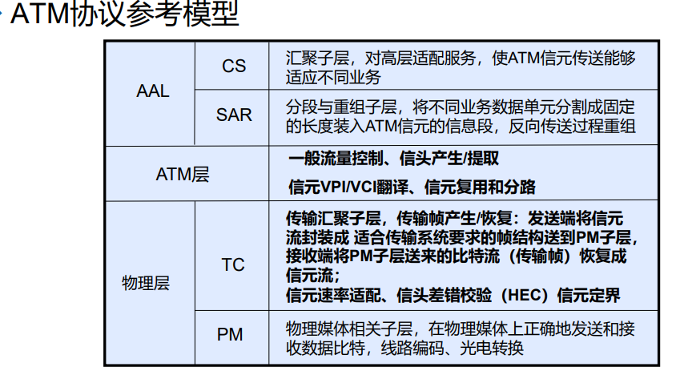
---
(2)ATM层：主要功能是负责信元的交换、选路和复用
(3)ATM适配层
 1）AAL的功能：ATM适配层（AAL）在ATM层之上增加适配功能，使
ATM信元传送能够适应不同业务，并将高层的不同业务数据单元分割成固
定的长度装入ATM信元的信息段，反向传送时完成逆过程。
 AAL的功能可以分为两个逻辑子层：
分段和重组子层（SAR：Segmentation And Reassembly）
分段和重组子层可简称为拆装子层，其主要功能是将高层
信息进行分割，以适合于装入ATM信元的信息段，或者反之。
汇聚子层（CS：Convergence Sublayer）
汇聚子层的主要功能是在AAL业务接入点（SAP）对高
层提供AAL的服务，其具体功能与业务类型有关。

❖ ATM交换的基本原理
ATM交换是指ATM信元从输入端的逻辑信道到输出端的逻辑信道
的消息传递。即任一入线上的任一逻辑信道的信元能够交换到任一
出线上的任一逻辑信道上去。
ATM交换系统三种基本功能：
信头翻译 路由选择 排队

❖ ATM交换网络的缓冲策略
外部缓存(1)——输入缓存模型
外部缓存(1)——输入缓存的缺点
 在入线处的队列将需要更多的缓冲容量
 存在队头阻塞（HOL）
外部缓存（2）——输出缓存
 去往同一条出线的多个信元可以在同一个信元周期内交换到出线上，不存
在队头阻塞；
 不需要仲裁逻辑；
 为保证没有信元丢失，在传输交换媒体中信元的传输交换的速率必须 N 倍
于入线的速率；
外部缓存(3)——输入输出缓冲
 输入输出缓冲综合了输入缓冲与输出缓冲的优点。假设其加速因子为L
外部缓存(4)——环回缓冲
 环回缓冲包括环回端口以及环回缓冲器。
当出线竞争发生的时候，在竞争中失败的
信元会通过环回端口存储在环回缓冲器中，
并且通过环回端口在下一时隙与新到来的
信元重新进行竞争。

❖ IP 与ATM融合的两种模式
重叠模型
 IP层运行在ATM层之上，把ATM网络看成另一种异型子网
 两种独立选路协议，IP/ATM选路协议
 两个地址空间（IP地址与ATM地址）
 需要地址解析功能，IP/ATM地址映射
优点
无需进行任何改动,有利于它们独立地发展
缺点
重复，因而网络扩展性不强、不便于管理、IP分组的传输效率较低。

集成模型
 ATM层与IP层对等，消除复杂网络间映射；
 单一的IP地址空间和IP选路协议；
 需要控制协议（将三层的选路信息映射到二层直通交换机制）；
 采用ATM交换机构，但不使用ATM信令，使用与IP更为相容的协议。
 变无连接方式为面向连接方式，基于短的标记交换进行数据分组的转发，速度快。
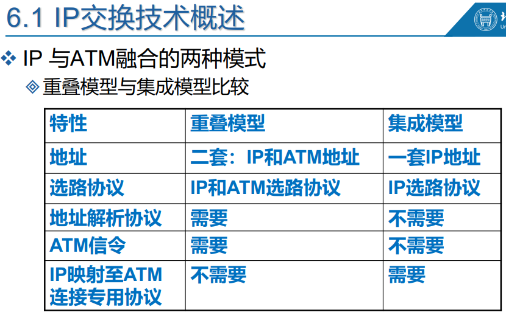

❖ MPLS ——Multi-Protocol Label Switching
MPLS利用标记（label）进行数据转发。当分组进入网络时，要为
其分配固定长度的短的标记，并将标记与分组封装在一起，在整个
转发过程中，交换节点仅根据标记进行转发。
MPLS将第二层的快速交换和第三层的路由有机地结合起来。第三
层的路由在网络的边缘实施，而在MPLS的网络核心采用第二层交
换。不改变现有的路由协议，对请求实现一次路由选择，多次交换。
MPLS采用面向连接的工作方式。
MPLS具有“多协议”特性，对上兼容IPv4、IPv6等多种主流网络
层协议；对下支持ATM、FR、PPP等多种链路层协议，从而使得
多种网络的互连互通成为可能。

转发等价类
FEC：一组具有相同特性并以相似的方式在网络
中转发的数据分组。对于相同类别的数据分组，网络节点对
其作相同处理，如：预留相同的网络资源、赋予相同的标记
，具有相同选路策略。

标记
包含于每个分组中的短的、具有固定长度的值（标志）
，用来标识和区分转发等价类FEC。
标记映射就是将标记分配给FEC，一个FEC可以对应多个标记，
但一个标记只能对应一个FEC。